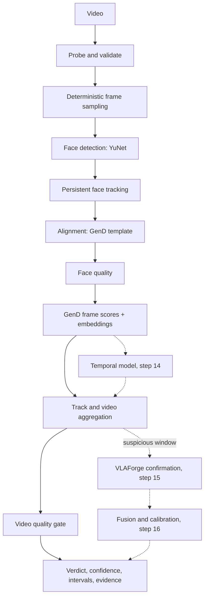

# Architecture

## Goal and constraints

The system estimates how likely it is that the faces in a video were manipulated (face
swap first, FaceFusion in particular). Three constraints shape everything:

1. **The output is probabilistic, never proof.** Verdicts are `authentic_likely`,
   `inconclusive` and `manipulated_likely`. Weak evidence leads to `inconclusive`.
2. **Low quality never raises the score.** Quality is a separate signal. It can make a
   verdict more cautious, but it can never make one more "manipulated".
3. **One engine, many front ends.** The same engine serves the web app, the API, the
   benchmark, and later the streaming engine and the Teams/Zoom integrations.

## Packages

```
packages/detector  deepfake-core   the engine; no web framework, no benchmark code
apps/api           deepfake-api    FastAPI service: uploads, job queue, results, retention
apps/web           deepfake-web    React + Vite SPA: upload and results UI
benchmarks         deepfake-bench  FaceFusion attack lab + evaluation (internal, never shipped)
```

Dependencies point one way: `api → core`, `bench → core`, and `web → api` over HTTP only.
`tests/test_architecture.py` fails if `deepfake_core` imports the API, the bench,
FastAPI, scikit-learn or matplotlib.

## The detection cascade

Built in pass 1 (solid) and planned for later (dashed):



Where the later stages plug in:

| Stage | Hook | Input already available |
|---|---|---|
| Temporal model (14) | per-track scoring at track finalisation, next to the mean aggregator | `AnalysisTrace`: per-track timestamps and L2-normalised GenD embeddings at the sampling rate |
| VLAForge (15) | after aggregation, only for windows whose fast score is suspicious | suspicious intervals with track IDs and timestamps |
| Calibration (16) | between aggregation and the verdict bands | raw `manipulation_probability`; `calibration.method` is `"none"` until then |

There is no stub code for these stages; the hooks are documented here and in
[roadmap.md](roadmap.md).

## Engine data flow

`Analyzer` loads the models once. `Analyzer.analyze(path)` streams the video. Frames are
decoded sequentially, and only sampled frames are converted to RGB. Each sampled frame goes
through detection, the online tracker, alignment and face quality. GenD then scores the
crops in batches. Nothing holds every frame in memory, which keeps the same structure usable
for the rolling-buffer streaming engine (step 20).

The output is `AnalysisOutput(result, evidence, trace)`:

- `result`: `AnalysisResult`, the public JSON contract (`schemas.py`, `schema_version`).
- `evidence`: up to four JPEG face crops of the highest-scoring frames.
- `trace`: per-detection timestamps, scores, quality and embeddings. The benchmark keeps
  it as training input for step 14. The API discards it.

## Quality gate

Quality is graded `GOOD`, `FAIR`, `POOR` or `INSUFFICIENT` from video-level metrics
(resolution, effective fps, bits per pixel, frame availability) and face-level metrics
(crop size, blur, lighting, pose and occlusion proxies). Quality only does three things:

- frames graded `INSUFFICIENT` are not scored;
- `POOR` widens the verdict bands, and `INSUFFICIENT` forces `inconclusive`;
- confidence is capped (`FAIR` at medium, `POOR` at low).

Property tests enforce that worse quality never moves a verdict towards "manipulated"
and never raises confidence.

## Configuration and versioning

Every threshold lives in `PipelineConfig`. Its profile name (`uncalibrated-v0` until the
benchmark tunes it) and a hash of its canonical JSON go into every result, together with
the pipeline version and the revision and sha256 of every model. The same file and config
always give the same sampled frames, tracks and scores.

## API and storage (summary)

The API accepts an upload, validates it, queues a job, and returns `202` with an
`analysis_id`. A single worker thread owns the one `Analyzer` instance. The original video
is deleted as soon as the analysis finishes, whether it succeeded or not. Results and
evidence crops expire after a TTL (24 h by default), and the user can delete them at any
time. See [privacy.md](privacy.md) and [ADR 0005](adr/0005-async-jobs-single-worker.md).
