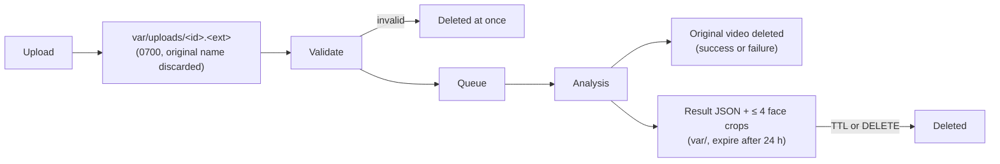

# Privacy and data handling

Uploaded videos are temporary processing data. The system does not build a facial dataset
from user uploads, and it never identifies anyone.

## Lifecycle of an upload

1. The browser sends the file to `POST /api/v1/analyses`. Only the file **extension** is
   taken from its name, and the name itself is never stored or logged. During the request
   Starlette may buffer the multipart body in an anonymous temporary file, which is
   already unlinked on POSIX. The upload is then copied to `var/uploads/<analysis_id>.<ext>`
   (directory mode 0700, file mode 0600).
2. If validation fails, the file is deleted immediately.
3. The single worker analyses the video. Whatever the outcome, the worker deletes the
   original in a `finally` block. At startup, any leftover upload is swept, and jobs
   interrupted by a restart are marked failed.
4. What remains is the result JSON and up to four aligned face crops (224 px JPEG) of the
   highest-scoring frames. Both are deleted after the TTL (24 h by default,
   `DFD_RESULT_TTL_HOURS`) or when the user calls `DELETE /api/v1/analyses/{id}` (the "Delete
   my data" button).

## Never stored

- The video and its file name.
- Full frames. Evidence is limited to aligned face crops.
- Face embeddings. GenD's embeddings exist only in memory during analysis. The research
  trace (`.npz`) is written only by the benchmark, on lab data, never by the API.
- Audio. The audio track is never decoded.
- Identity. Tracking is geometric (box positions over time). No face recognition runs, and
  no face is compared with any other face.

Logs carry analysis IDs only. Access logs contain request paths, which include analysis
IDs but no personal data.

## Access model (V1)

V1 has no accounts. An analysis ID is a random 128-bit value and works as a capability:
anyone who holds the result link can view or delete the result until it expires. Share
links accordingly. Production deployments (roadmap step 18) need authentication, rate
limiting, HTTPS termination and a request body limit at the reverse proxy.

## Research data is separate

The FaceFusion attack lab works only under `$DFD_DATA_ROOT` (default `./data`, gitignored).
It never reads from or writes to the API's `var/`. Every identity in the lab needs a recorded
`consent_ref`, and consent withdrawal is supported (`dfbench identity delete`). See
[lab/data-collection.md](lab/data-collection.md).

## Before production use

Face video of job candidates is sensitive. Recruitment is a high-risk use case under the
EU AI Act (Annex III), and data-protection law will usually require a data protection
impact assessment. Get legal review before any HR deployment. The product must stay
decision support only: never an automated rejection, never a claim that a person is
fraudulent.
